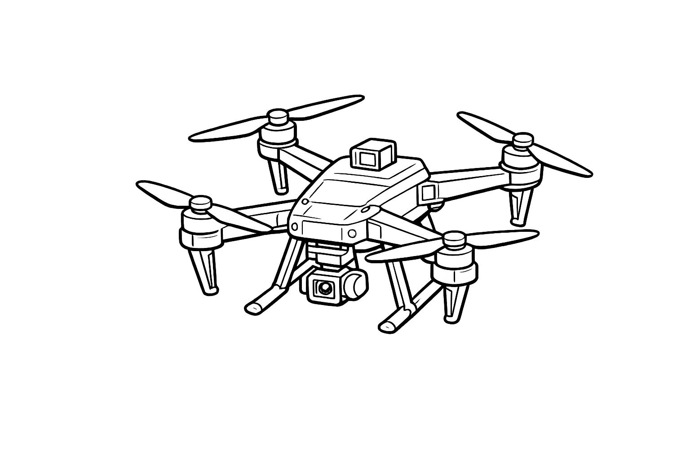

# Crazyflie @ University of Illinois, Urbana Champaign

  

Central index for all Crazyflie work at the University of Illinois, Urbana Champaign.

This repo points you to the right repo and the right person. Setup, demo, and hardware docs live in each linked repo.

---

## Repositories

| Repo | Purpose | Status |
|---|---|---|
| [fa26-drone-track-release](https://github.com/safeautonomy-illinois-students/fa26-drone-track-release) | ECE484 Fall '26 student starter code | Active (ECE484 students repo) |
| [crazyflie-Lab](https://github.com/IllinoisReliableAutonomyGroup/Crazyflie-Lab) | Crazyflie 2.1 Brushless and AI-deck research SDK | Active |
| [crazyflie-firmware](https://github.com/IllinoisReliableAutonomyGroup/crazyflie-firmware) | Crazyflie firmware source and development | Reference |

## Access

- **Public resources:** This repository serves as the central index for Crazyflie projects, documentation, and research at UIUC.
- **Students:** Access course-specific starter code and other publicly available repositories linked above.
- **Researchers and contributors:** Access individual project repositories according to their respective permissions.
- **Restricted resources:** Internal demonstrations and other restricted research materials are maintained separately and are accessible only to authorized personnel.

## Adding Your Repo

1. Link your repo here to `UIUC-Robotics`.
2. Add the GitHub topic `crazyflie`.
3. Open a PR adding a row to the table above.

## Contacts

Center for Autonomy, UIUC - Staff
